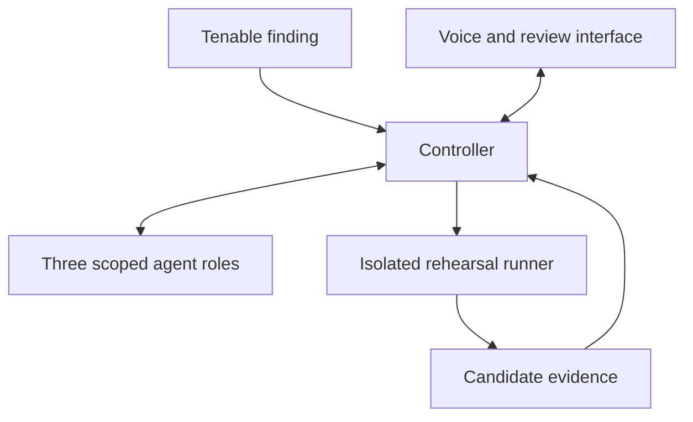

# Remediate by Agent9

### Security updates, tested before deployment.

Remediate is an open source project being built for Tenable SWARM. It will turn a Tenable finding into a tested application update and the evidence an engineer needs to review it.

The planned workflow connects a real finding to a controlled application, prepares a bounded candidate, runs the same accepted workflows against baseline and candidate, checks the runtime actually serving the application, and exports a review package. An interruptible voice interface will make the evidence easy to question and inspect.

**Current status: engineering foundation.** The complete build specification and development handoff are available. The integrated application, Tenable adapter, agent workflow, runner, and speech experience have not been implemented or verified in this repository. The owner has confirmed access to a Tenable account with Hexa for testing; the first authenticated finding read is an initial milestone.

## Start here

| Your goal | Read |
| --- | --- |
| Understand the complete engineering plan | [Build plan](docs/BUILD_PLAN.md) |
| Resume development or start a new agent session | [Agent instructions](AGENTS.md), then [current state](docs/PROJECT_STATE.md) |
| See the next work and its completion criteria | [Flexible day-by-day roadmap](docs/ROADMAP.md) |
| Understand components, contracts, and trust boundaries | [Architecture](docs/ARCHITECTURE.md) |
| Prepare the competition submission | [Verified form questions and draft answers](docs/SUBMISSION.md) |
| Build and rehearse the audience demonstration | [Demo guide](docs/DEMO.md) |
| Check what claims are supported | [Validation and evidence requirements](docs/VALIDATION.md) |
| Understand why decisions were made | [Decision log](docs/DECISIONS.md) |
| Use and integrate Tenable safely | [Hexa integration plan](docs/TENABLE.md) |
| Contribute or hand off work | [Contribution guide](CONTRIBUTING.md) and [session log](docs/SESSION_LOG.md) |

## The outcome

An operator asks: **Can we address this finding without breaking the application, and what evidence supports the change?**

1. Read one authorized Tenable finding and map it to an explicit application recipe.
2. Approve a bounded rehearsal, including target, allowed changes, checks, resources, and budget.
3. Execute baseline and candidate workflows in isolated environments.
4. Inspect actual serving-runtime evidence and applicable advisory conditions.
5. Prepare permitted corrections and repeat the checks with a fresh candidate identity.
6. Review the candidate diff, workflow results, security evidence, and remaining gaps.

The first recipe targets a small PHP 8.4 customer portal with meaningful login, search, and upload checks. Exact runtime versions and advisory applicability must be established during implementation.

## A result worth challenging

The published demonstration fixture will pass its application checks while retaining the wrong serving runtime. Remediate must detect that contradiction from execution evidence. A reviewer can ask by voice to see the exact observation, inspect the corrected candidate, and try attaching an old successful result to the new candidate. That mismatched result must be rejected.

The useful deliverable is a review-ready update with a portable evidence bundle. Deliberate challenge fixtures, live execution, and saved replays will be labeled.

## Planned architecture



| Layer | Selected direction |
| --- | --- |
| Interface and service | Vite, Node.js, TypeScript |
| Job state and artifacts | SQLite and local artifact storage |
| Isolated execution | Rootless Podman and OCI images |
| Application assertions | Playwright Test |
| Agent roles | Exposure analyst, change engineer, verification agent |
| Reasoning | One configurable provider adapter initially |
| Local speech | Moonshine Voice recognition and Phonon 31m English synthesis, subject to the hardware gate |
| Integrations | Outbound Tenable Hexa MCP adapter and a small inbound Remediate MCP interface |

See the [complete plan](docs/BUILD_PLAN.md) for implementation detail, model-specific licenses, contingencies, and source references. Component selection is not a claim that integration is complete.

## The evidence rules

- Every result belongs to an exact candidate, target, test manifest, advisory snapshot, and execution attempt.
- The controller determines workflow state from runner evidence; model prose cannot assign a pass.
- Accepted tests are outside the change agent's writable workspace.
- Application behavior, candidate remediation evidence, and production verification remain separate outcomes.
- Bundle verification checks identity, integrity, required evidence, and consistency. It does not prove an execution host was uncompromised.
- Execution grants are enforced in the service for every client, including voice and MCP.

## Build at your own pace

The [seven-day roadmap](docs/ROADMAP.md) is an ordered set of milestones. A session can complete several days, or part of one day. Advance when the completion criteria pass; the labels do not impose waiting periods.

There is no application install or launch command yet. Start with [Day 1](docs/ROADMAP.md#day-1--prove-the-foundation), implement the foundation, and add tested setup instructions when they exist. The repository's documentation check is available now:

```sh
python3 scripts/check_docs.py
```

## Competition preparation

The supplied team-and-idea form is due **November 1, 2026**, with one response per team. It asks for the proposed tool and its exposure-reduction or time-saving value in one or two sentences. [Form details and prepared copy](docs/SUBMISSION.md).

The project remains open source and useful beyond the event. Additional stacks, production deployment integrations, SMS, and phone calls follow a successful first supported workflow.

## Contributing and license

Read [CONTRIBUTING.md](CONTRIBUTING.md) and [AGENTS.md](AGENTS.md) before changes. Keep measured results separate from plans and preserve required third-party notices when reusing code or model assets.

This repository's original contributions use [Apache License 2.0](LICENSE). Third-party source and model artifacts retain their own terms. See [the dependency policy](docs/DEPENDENCIES.md).
