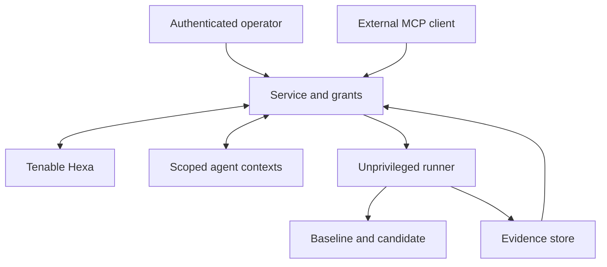

# Architecture and implementation contracts

Status: selected design, not an implemented system. The [full build plan](BUILD_PLAN.md) remains the complete specification; this document gives developers a focused map of boundaries and contracts.

## System boundary

Remediate runs a local service and review interface. The service owns credentials, jobs, grants, model calls, tool dispatch, and artifact metadata. An unprivileged execution adapter runs the controlled application recipe. Candidate code cannot read the controller database or credentials and cannot control the container runtime.

The first deployment is one authenticated operator/session with local speech. External model reasoning and Tenable calls remain network operations. The initial release prepares a candidate for review; it does not deploy to production or close a production finding.

## Module map

| Planned module | Responsibility | Must not own |
| --- | --- | --- |
| `apps/web` | Review, transcript, audio, evidence panels, action previews | Provider credentials or authoritative grant decisions |
| `apps/service` | Controller, API, state, durable work dispatch | Candidate application code execution in its own process |
| `packages/contracts` | Versioned schemas and validation | Environment-specific credentials |
| `packages/agents` | Roles and provider adapter | Final status assignment or self-approved authority |
| `packages/execution` | Typed dispatch, runner, isolation | Arbitrary host shell exposed to models |
| `packages/evidence` | Identity, manifest, exporter, verifier | Claims that hashes prove honest execution |
| `packages/voice` | Local recognition/synthesis adapters | A separate job or authorization model |
| `integrations/tenable` | Discovery, authentication, finding normalization | Imagined MCP tools or assumed scan entitlement |
| `fixtures/php-portal` | Redistributable application and synthetic cases | Real tenant or customer data |

These paths are proposed module boundaries. They are not claims that packages or entry points already exist.

## Contracts to establish first

Use runtime schema validation at every external boundary and version the serialized contracts.

| Contract | Required responsibilities |
| --- | --- |
| `Finding` | Source, finding ID, asset identity, observed component, `observed_at`, `retrieved_at`, context, evidence references |
| `ApplicationRecipe` | Explicit target mapping, source commit, build/start instructions, baseline, candidate constraints, synthetic data, fixed tests, verification requirements, allowed paths/network/resources |
| `Job` | Principal, recipe revision, grant, state, current candidate, attempts, budget, durable events |
| `RunSubject` | Job, attempt, target, source commit, build-context digest, candidate image digest, test-manifest digest, configuration/data identity, advisory snapshot, policy identity |
| `ExecutionGrant` | Principal, job/recipe, targets, tool source and pinned contract, argument/path constraints, expiry, resource limits, maximum attempts, revocation state |
| `EvidenceItem` | Producer, run subject, kind, timestamp, digest, artifact locator, provenance/redaction state |
| `Verdict` | Separate functional, candidate-security, and production states; exact subject; required supporting evidence and gaps |
| `ReviewDecision` | Authenticated reviewer, exact candidate/evidence identity, decision, timestamp |
| `VoiceReply` | Job revision, spoken text, valid evidence references, view action, optional proposed operation |

Do not use mutable image tags as candidate identity. Do not store readable secrets inside configuration snapshots or exported evidence. When secret presence affects behavior, record its identity/configuration role without exporting the secret value.

## Controller and durability

The happy path is `DRAFT → AWAITING_GRANT → BASELINE → CANDIDATE_BUILD → REHEARSAL → ASSESSMENT → REVIEWABLE`. Record `BLOCKED`, `INCONCLUSIVE`, `FAILED`, `CANCEL_REQUESTED`, and `CANCELLED` explicitly when applicable.

The controller owns transitions and associates each with its causal event. Persist job changes and outgoing work in one SQLite transaction through an outbox. Use leases and idempotency keys for workers. On recovery, reconcile known outputs and surface ambiguous external outcomes before retrying. Do not promise exactly-once execution across external services.

Each correction creates a new candidate and attempt. Previous evidence remains inspectable but cannot certify the new subject. A changed scope requires a new grant; permitted corrections inside the existing scope do not require redundant authorization. A final review decision belongs to the exact candidate it accepts.

## Authority and tools

The first Remediate tool surface can include `inspect_finding`, `inspect_recipe`, `propose_candidate`, `run_rehearsal`, `inspect_evidence`, and `request_cancellation`. These are proposed Remediate tools, not asserted Tenable tool names.

Pin the source and advertised contract, including descriptions, schemas, and annotations. A changed contract invalidates the corresponding approval pending review. Metadata pinning does not attest that a remote implementation stayed unchanged.

Check grants at dispatch and again at execution. A revoked queued action must fail. For already-running work, record cancellation requested, whether it stopped, and retained partial evidence. The UI, CLI, voice interface, and incoming MCP requests all use this path.

The local service needs authenticated sessions and strict origin checks. A local address alone is not authorization. Agents can request an operation but cannot create grants or broaden allowed targets.

## Runner and test integrity

1. Materialize only the approved source/build context in isolated temporary directories.
2. Acquire pinned dependencies through an explicitly permitted phase.
3. Mount the accepted test harness read-only from outside the changeable workspace.
4. Start baseline/candidate with bounded CPU, memory, time, filesystem, and egress access.
5. Run the same assertions with recorded configuration and seed.
6. Associate the HTTP test target with container/image identity and the actual serving process.
7. Capture assertion outcomes, traces, runtime observations, and infrastructure errors with the run subject.
8. Clean up using a known lifecycle while retaining the intended artifacts.

An application endpoint's version report is supplemental. A PHP CLI version from an unrelated process does not establish the PHP-FPM runtime serving the tested request.

The baseline must pass the accepted functional expectations before a compatibility comparison is meaningful. Infrastructure failure is distinct from an assertion failure. An agent cannot silently weaken tests or relabel a regression as an infrastructure problem.

## Evidence and result semantics

| Dimension | States |
| --- | --- |
| Application behavior | passed / failed / inconclusive |
| Candidate remediation | supported / contradicted / pending |
| Production verification | pending / externally verified |

The verification plan declares required observations. Missing required scanner evidence remains pending even when version/configuration checks look promising. The same target and candidate identity must cover every required observation.

Use an in-toto Statement v1 envelope with artifact subjects and a versioned project predicate. Export the change, image reference, observations, assertions, traces, authorization summary, timing/usage, and reproduction instructions. The verifier recalculates hashes and validates identities, required evidence, and consistency. Optional signatures need separately configured trust; a key supplied inside an untrusted bundle does not establish it.

## Voice state and interruption

Recognition and synthesis run in browser workers when supported. Show model downloads and processing location; cache pinned artifacts. Keep the single-thread browser contingency if the multithreaded runtime needs unavailable isolation headers.

Partial transcripts may update the display and prepare read-only retrieval. Consequential operations require a completed utterance resolved to a visible target/action and an appropriate grant. An open-ended question retrieves relevant evidence using the existing reasoning adapter; exact state lookups can bypass model calls.

On interruption, increment the answer generation ID, abort synthesis, stop queued playback nodes, cancel the old request where possible, and discard late chunks. Job cancellation is a separate controller operation. Validate every evidence reference against the current job revision before presenting an answer.

## Cost and limits

Start with one model provider, an estimated configurable $1 model budget per rehearsal, and at most two correction revisions. Reserve estimated cost before dispatch, bound outputs, account for retries, and report observed usage. These are proposed application controls; the price and final invoice depend on the provider and actual work.

Local speech and containers use the operator's hardware. An optional hosted recognition adapter is a contingency. Do not make introductory credits necessary for the project to remain usable.
